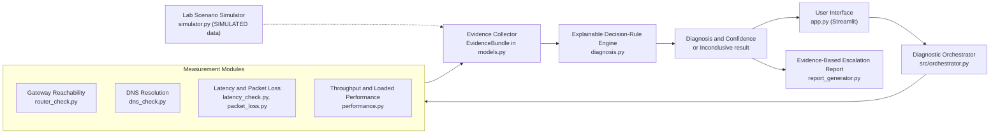

# Architecture

Proposed in the project proposal (slide 7) and implemented as the modules below.
Diagrams use Mermaid, which GitHub draws automatically.

## Modules

| Proposal component | File | Job |
|---|---|---|
| User Interface | `app.py`, `src/charts.py` | Dashboard, Start Diagnosis, charts, downloads |
| Diagnostic Orchestrator | `src/orchestrator.py` | Runs the live steps in order and reports progress |
| Gateway Reachability | `src/router_check.py` | Finds the default gateway (Windows `ipconfig`, Linux `ip route`, macOS `route`) and pings it repeatedly |
| DNS Resolution | `src/dns_check.py` | Finds DNS servers; sends real DNS queries (UDP 53) or uses the OS resolver; times each lookup |
| Latency and Packet Loss | `src/latency_check.py`, `src/packet_loss.py` | One ping per probe; average, median, min/max, std dev, jitter, loss % |
| Throughput and Loaded Performance | `src/performance.py` | Controlled busy link (parallel downloads) and normal-vs-busy comparison. Not a bandwidth test |
| Evidence Collector | `src/models.py` | Dataclasses: every module returns the same kind of object |
| Explainable Decision-Rule Engine | `src/diagnosis.py` | Rules R0 to R7 and C, confidence levels, Inconclusive handling |
| Escalation Report | `src/report_generator.py` | Markdown and HTML reports |
| Controlled Test Environment / Fault injection | `src/simulator.py` | SIMULATED scenarios only. Real fault injection is planned lab work |

## Design decisions

* **One output format.** Each measurement module returns `ProbeStats`, `DnsResult` or `LoadInfo`, so the rules stay
  readable and each module can be tested alone (as the proposal asks).
* **Repeatable tests.** Probe counts, timeouts, targets and domains are settings, saved in every report (RFC 2330 idea).
* **Per-probe records.** Ping runs one probe at a time, so we know which probes were lost and can show a chart of them.
* **Honest "unavailable".** If the gateway, ping or DNS check cannot run, the result is marked unavailable and the
  rules treat it as missing evidence. They never invent a value.
* **Safe input.** Host names are validated and commands are run without a shell.
* **Simulated vs real.** Every `EvidenceBundle` has `source = "real" | "simulated"`. The dashboard and reports show it.

## Decision rules (proposed limits, not validated)

| Rule | Fires when | Notes |
|---|---|---|
| R0 | fewer than 2 of 3 core checks usable | leads to Inconclusive |
| R1 Router unreachable | every router probe fails | High if the external target also fails, otherwise Medium |
| R2 DNS failure | at least half of lookups fail while a direct IP ping works | High if all fail (3+ domains); Low for a minority of failures |
| R3 Slow DNS | median lookup time above the limit | Medium |
| R4 Packet loss | loss at or above the limit and at least 2 lost probes | local segment if the router loses probes too |
| R5 High latency | median external RTT above the limit | |
| R6 Congestion hint | latency, jitter or loss clearly worse under load (needs healthy baseline) | High = 3 indicators, Medium = 2, Low = 1 |
| R7 No fault detected | all three core checks usable and nothing fired | |
| C Conflict | router silent but internet works, or external silent but router fine | leads to Inconclusive |

Limits are in `Thresholds` (`src/diagnosis.py`) and can be changed in the app sidebar.
