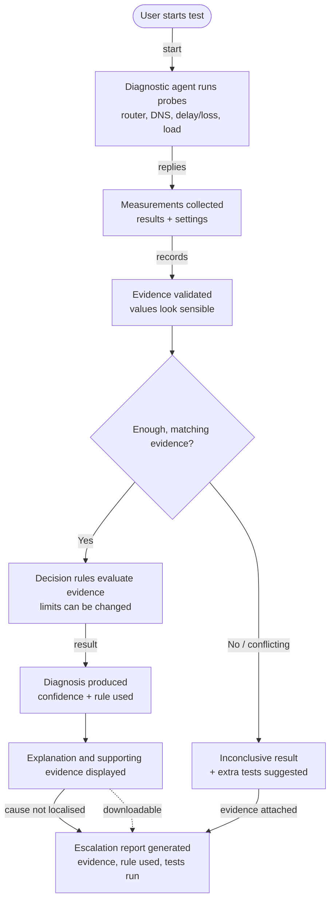

# Data Flow Diagram

Matches the proposal's Data Flow Diagram (slide 8), including the Inconclusive path.

## Where each step lives in the code

| Step | Code |
|---|---|
| User starts test | "Start Diagnosis" button in `app.py` |
| Probes run | `orchestrator.run_live_diagnosis` calling `router_check`, `dns_check`, `latency_check`, `performance` |
| Measurements collected | `EvidenceBundle` (`models.py`) with the saved `TestSettings` |
| Evidence validated | `_usable()` in `diagnosis.py`: enough probes? check available? load really applied? |
| Enough, matching evidence? | Rules R0 and C in `diagnose()` |
| Decision rules | R1 to R7 in `diagnose()` with `Thresholds` |
| Diagnosis, confidence, rule | `Diagnosis` dataclass |
| Explanation and evidence | "Why this answer" tab in `app.py` |
| Escalation report | `report_generator.py` and the Download Report buttons |

In the lab simulator the "probes" step is replaced by `simulator.simulate_scenario()`; everything after that is identical.
